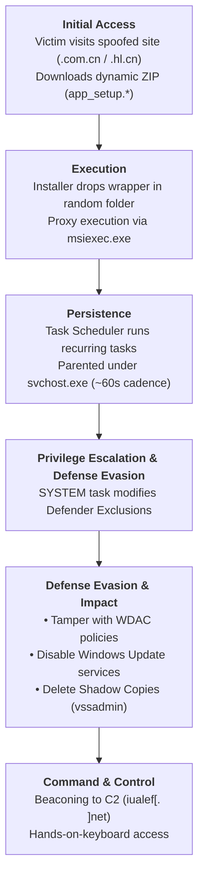

# Lab 1
## Author
Jonathan Bronfman
## Source
**Title:** Counterfeit installers to system compromise: Tracking a deceptive software download campaign

**Publisher:** Microsoft Security Research, Microsoft Defender Experts, and Parth Jomadkar

**Publication Date:** September 1, 2026

**URL:** https://www.microsoft.com/en-us/security/blog/2026/09/01/counterfeit-installers-system-compromise-tracking-deceptive-software-download-campaign/  
## Attack Summary
This threat intelligence report documents an active cyber campaign targeting Windows endpoints—predominantly associated with Chinese-language users and operations—through deceptive software download portals (e.g., look-alike `.com.cn` and `.hl.cn` domains impersonating legitimate software like Razer or Microsoft Edge). The primary objective of the threat actors is initial access, persistent host compromise, defense evasion, and establishing command-and-control (C2) channels for follow-on exploitation or hands-on-keyboard activity.

The attack sequence begins when users are lured via SEO poisoning or spoofed links to clone websites. Downloading the installer retrieves a ZIP archive containing a malicious payload. A key evasive tactic is server-side dynamic payload generation: the file name remains constant (e.g., `app_setup.zip`), but the hash changes on every download request to defeat static hash-based blocklists. Upon execution, the malware uses Windows components like `msiexec.exe` to run installers, creates scheduled tasks for persistence, launches short-lived elevated scheduled tasks running as `SYSTEM` to disable Windows Defender AV/exclusions, deletes Volume Shadow Copies via `vssadmin.exe`, disables Windows Update services, and connects to C2 infrastructure using cloud object storage and dedicated domains.

## Attack Sequence

## MITRE ATT&CK Mapping Table

| Observed Behavior | ATT&CK Tactic | Technique / ID | Evidence & Mapping Rationale | SOC Telemetry / Investigation |
| :--- | :--- | :--- | :--- | :--- |
| **1. Delivery via Spoofed Domain** | Initial Access | Malicious Software / **T1204.002** (User Execution: Malicious File) & **T1566.002** (Phishing: Spearphishing Link) | **Report Passage:** "The entry point is a fraudulent software-download website that spoofs a legitimate vendor... retrieves a malicious installer archive..." **Rationale:** Users are lured to spoofed domains and tricked into downloading and executing malicious software installers. | Web Proxy / DNS logs, Browser downloads, EDR web telemetry (`FileOriginReferrerUrl`). Check referrer URLs for `.com.cn` or `.hl.cn` domains. |
| **2. Proxy Execution via Windows Installer** | Defense Evasion, Execution | System Binary Proxy Execution: Msiexec / **T1218.007** | **Report Passage:** "...use the Windows Installer service to execute payloads through msiexec.exe, allowing malicious activity to run under a legitimate Microsoft-signed process." **Rationale:** Legitimate Windows utility `msiexec.exe` is abused to proxy the execution of malicious MSI payloads. | EDR Process Creation logs (Event ID 4688 / Sysmon Event ID 1). Inspect parent process, MSI command-line arguments (e.g., `-Embedding`), and payload origin. |
| **3. Automated Execution Cadence via Task Scheduler** | Persistence, Privilege Escalation, Execution | Scheduled Task/Job: Scheduled Task / **T1053.005** | **Report Passage:** "...payloads are launched by the Task Scheduler service (parented to svchost.exe -k netsvcs -p -s Schedule)... exhibits a characteristic ~60-second re-execution cadence." **Rationale:** The malware registers Windows scheduled tasks to maintain continuous execution. | Windows TaskScheduler Logs (Event ID 106, 140, 200/201) and Process Telemetry. Filter for `schtasks.exe` creation and `svchost.exe` spawning randomized binaries. |
| **4. Modifying Defender Exclusions & Policies** | Defense Evasion | Impair Defenses: Disable or Modify Tools / **T1562.001** | **Report Passage:** "A SYSTEM scheduled task writing HKLM\...\Windows Defender\Exclusions\Paths then self-deleting... behavior detected as Behavior:Win32/MpTamperGpDisableAVFriendly." **Rationale:** Attacker modifies Defender registry paths and WDAC policies to suppress detection. | Windows Security Event Logs (Event ID 4657 - Registry Modification), PowerShell logs, Microsoft Defender Alerts. Monitor registry modifications in `HKLM\SOFTWARE\Policies\Microsoft\Windows Defender`. |
| **5. Deleting Volume Shadow Copies** | Impact | Deface / Inhibit System Recovery / **T1490** | **Report Passage:** "...vssadmin delete shadows /all /quiet..." **Rationale:** `vssadmin.exe` is called with silent deletion flags to eliminate volume shadow copies and prevent system recovery. | Process Creation telemetry (Sysmon Event ID 1). Alert on `vssadmin.exe` invoked with `delete shadows` flags. |
| **6. Disabling Windows Update Services** | Defense Evasion | Impair Defenses: Disable OS Logs/Services / **T1562.001** | **Report Passage:** "...disabling wuauserv, UsoSvc, WaaSMedicSvc and uhssvc are high-fidelity signals." **Rationale:** The threat actor systematically halts and disables native Windows Update services to block automatic patching. | Service Control Manager logs (Event ID 7040 - Service startup type changed), PowerShell/CMD process logs (`sc config`, `net stop`). |

## SOC Investigation Notes

### Behavior A: Proxy Execution via `msiexec.exe` (T1218.007)
* **Telemetry Source:** EDR Process Creation Logs (Sysmon Event ID 1, Windows Event ID 4688), Process Lineage Data.
* **Tier 1 Analyst Triage:** 
  1. Inspect the alert fired for `msiexec.exe` spawning from non-standard parent processes or carrying unusual flags (e.g., `-Embedding` or execution pointing to temporary/public directories).
  2. Verify the source file location of the MSI package or wrapper (e.g., `C:\Users\Public\` or `C:\Users\<user>\AppData\Local\Temp\`).
  3. Validate if the execution was initiated by a user-driven installer download or an automated process.
* **Tier 2 Analyst Investigation:** 
  1. Analyze the command line parameters and reverse-engineer/inspect the MSI binary payload executed by `msiexec.exe`.
  2. Correlate web proxy and browser telemetry (`FileOriginReferrerUrl`) to trace which URL dropped the file prior to execution.
  3. Perform process tree analysis to identify any child processes spawned by `msiexec.exe` (e.g., `cmd.exe`, `powershell.exe`, or dropped DLLs).

### Behavior B: Disabling Defender Protections via Registry (T1562.001)
* **Telemetry Source:** Windows Security Registry Audit Event Logs (Event ID 4657), Defender Antivirus Alert Telemetry, EDR Process/Registry Monitoring.
* **Tier 1 Analyst Triage:** 
  1. Review alerts concerning modifications to `HKLM\SOFTWARE\Policies\Microsoft\Windows Defender\Exclusions`.
  2. Identify the process and user context executing the registry write (e.g., `NT AUTHORITY\SYSTEM` via `schtasks.exe`).
  3. Determine if the change was performed as part of an authorized IT administrator maintenance window or SCCM/GPO push.
* **Tier 2 Analyst Investigation:** 
  1. Identify the specific scheduled task that executed the registry modification command and check for self-deletion behavior.
  2. Pivot to surrounding endpoint activities (±15 minutes) to identify dropped binaries residing within the newly excluded folder paths.
  3. Initiate automated host isolation via EDR if administrative authorization is absent.

### Behavior C: Deleting Volume Shadow Copies via `vssadmin` (T1490)
* **Telemetry Source:** Process Creation Telemetry, Command Line Auditing, EDR Behavioral Alerts.
* **Tier 1 Analyst Triage:** 
  1. Filter for `vssadmin.exe` execution where command-line arguments include `delete` and `shadows`.
  2. Check whether the command was executed interactively or via an automated batch/scheduled script.
  3. Verify if any backup software (e.g., Veeam, ShadowProtect) initiated the command during scheduled routine maintenance.
* **Tier 2 Analyst Investigation:** 
  1. Treat non-backup `vssadmin` shadow copy deletions as a high-severity indicator of imminent ransomware or destructive activity.
  2. Immediately isolate the affected host network interface to prevent lateral movement or network-wide encryption.
  3. Perform host memory dump analysis and inspect network telemetry for active command-and-control communication (e.g., IP/domain connections to `iualef[.]net`).

---

## Mapping Uncertainty and Discussion

### Uncertain Mapping Identified
* **Behavior:** Disabling Windows Update Services (`wuauserv`, `UsoSvc`, `WaaSMedicSvc`, `uhssvc`).
* **Primary Mapping:** *Defense Evasion — Impair Defenses: Disable OS Logs/Services (**T1562.001**)*.
* **Alternative Interpretation:** *Impact — Service Stop (**T1489**)*.

### Rationale
Disabling system update services can be interpreted under two distinct ATT&CK tactics depending on the attacker's intent:
1. **Defense Evasion (T1562.001):** The threat actor disables Windows Update to prevent the operating system from receiving security patches, hotfixes, or updated Defender definitions that might detect or mitigate the deployed malware.
2. **Impact (T1489):** Stopping core operating system services degrades system availability and disrupts normal operational maintenance.

### Resolving Evidence Required
To confirm the correct mapping, analysts would need:
* **To confirm T1562.001 (Defense Evasion):** Telemetry showing the attacker subsequently dropping exploitation tools or older vulnerabilities on the host that would otherwise be patched by pending Windows updates, or evidence that updates were suppressed specifically during active infection to maintain persistence.
* **To confirm T1489 (Impact):** Evidence that disabling the services was part of a broader denial-of-service or system destruction routine intended to leave the host permanently inoperable or unmanageable.

Given the CTI report's emphasis on maintaining host persistence and systematically disabling security controls (Defender exclusions, WDAC policy tampering), the primary mapping to **T1562.001 (Defense Evasion)** is the most substantiated choice.